# Projet : mise en production du portail de suivi des tournées

David, BTC2 Administration d'un Linux Server. Machines virtuelles srv-core et srv-edge sous Rocky Linux 9.8.

Pour ce projet, j'ai mis en service un petit portail web qui affiche l'état du collecteur de télémétrie. Cet état est écrit dans un fichier, etat.json, mis à jour toutes les 2 minutes. J'ai fait en sorte que le portail redémarre tout seul, qu'il ait le moins de droits possible, qu'il ne soit accesible que depuis le réseau métier, qu'il soit supervisé et qu'il soit sauvegardé.

Avant de commencer, j'ai vérifié que mon serveur était bien dans l'état de fin du TP3, puis j'ai pris l'instantané 04-debut-projet. Mes fichiers de configuration sont dans le dossier configs, les sorties complètes de mes commandes dans le dosier preuves, et mes captures d'écran dans preuves/captures.

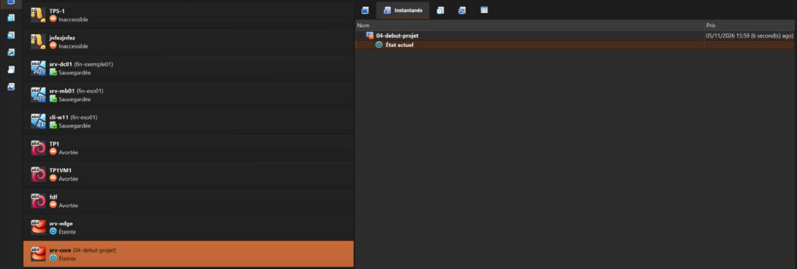

## 1. Conformité

J'ai commencé par intaller l'agent Zabbix, parce que c'est lui qui crée le compte zabbix dont j'avais besoin pour les droits du dossier www.

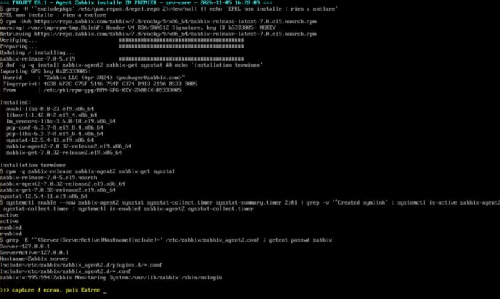

E1, les comptes. J'ai créé lea dans le groupe suivi. Son mot de passe expire au bout de 90 jours, elle ne peut pas le changer plus d'une fois par jour, elle est prévenue 14 jours avant, et son compte est désactivé 7 jours après l'expiration. Elle n'est ni dans wheel ni dans ssh-admins. Le compte helios-suivi est un compte sytème, sans shell et sans dossier personnel.

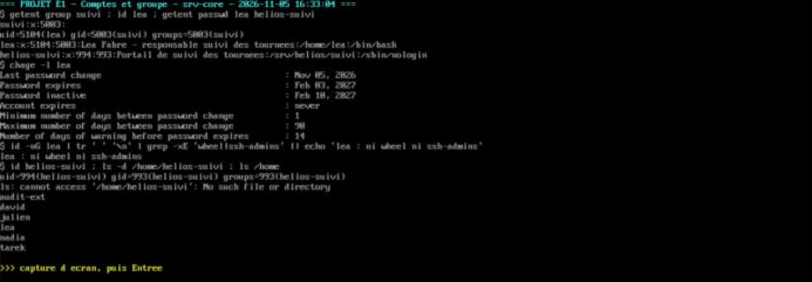

E2, les droits sur le dossier www. Le dossier appartient à root et au groupe suivi, avec le bit setgid pour que les fichiers restent dans le groupe suivi. Avec les ACL, helios-suivi peut tout faire dans le dossier, et zabbix peut seulement le traverser. Un fichier créé par lea garde les bons droits, meme quand elle utilise un umask très fermé (077). Nadia, qui n'est pas dans le groupe, n'a pas accès au dossier.

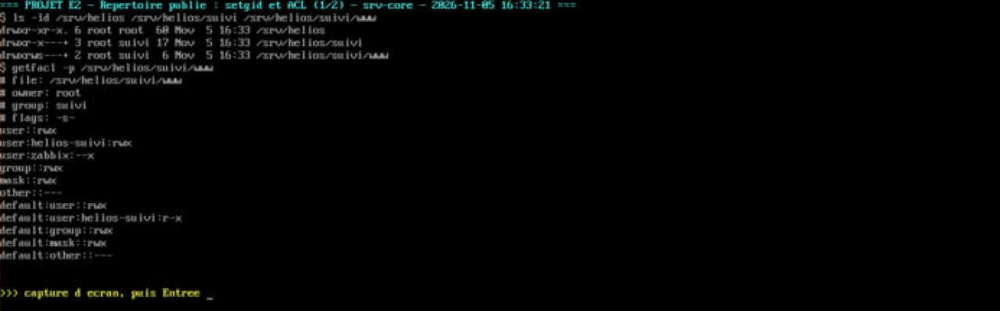

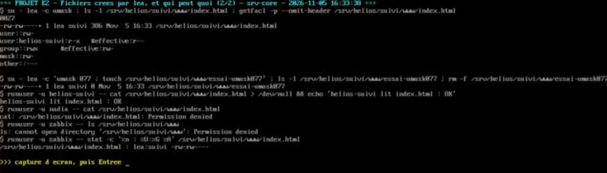

E3, le script de publication. J'ai provoqué chaque code retour. Le script renvoie 0 quand tout va bien, 2 quand une autre exécution est déja en cours, 3 quand un prérequis manque, et 1 quand la ligne de télémétrie est invalide. Le fichier JSON produit est valide, et chaque exécution est notée dans le journal.

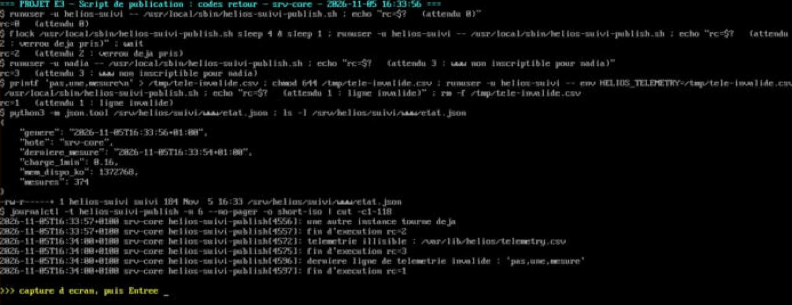

E4, les services systemd. Le portail tourne sous le compte helios-suivi et il est limité à 128 Mo de mémoire et à la moitié d'un processeur. Son score de sécurité est de 1.2, alors qu'il falait moins de 4. Les deux pages répondent correctement, et quand je tue le processus de force, le portail revient tout seul en 2,7 secondes.

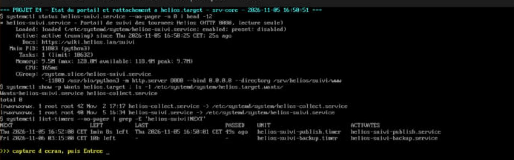

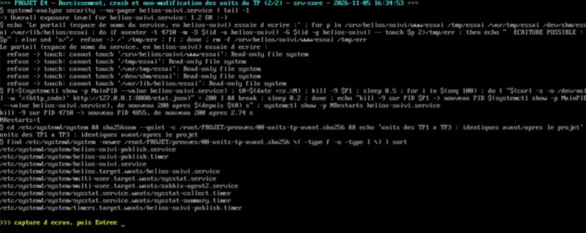

E5, sudo. Le fichier sudoers est valide et protégé. Lea peut redémarrer le portail et lire son journal, mais elle ne peut pas redémarer sshd ni vider le journal du serveur.

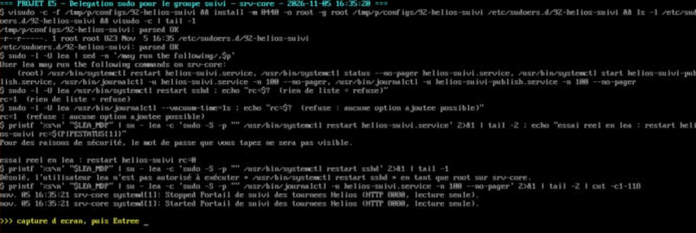

E6, le pare-feu. Le port 8080 est ouvert seulement dans la zone internal, qui corespond au réseau métier. Depuis srv-edge, le portail répond sur l'adresse métier 10.42.0.10, et il est bloqué sur l'adresse d'administration 192.168.56.10.

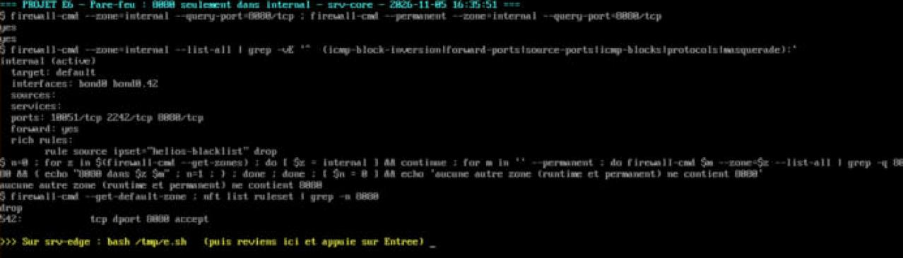

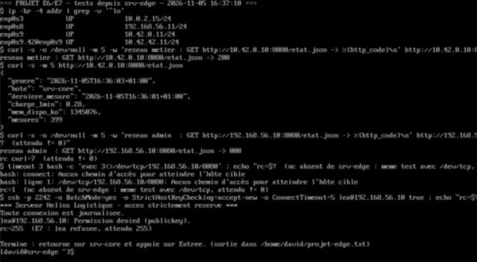

E7, la non-régression. SSH est toujours sur le port 2242, sans connexion root, sans mot de passe, et seulement pour le groupe ssh-admins. Lea est donc bien refusée en SSH. Le journal est toujour conservé après redémarrage et SELinux est toujours actif.

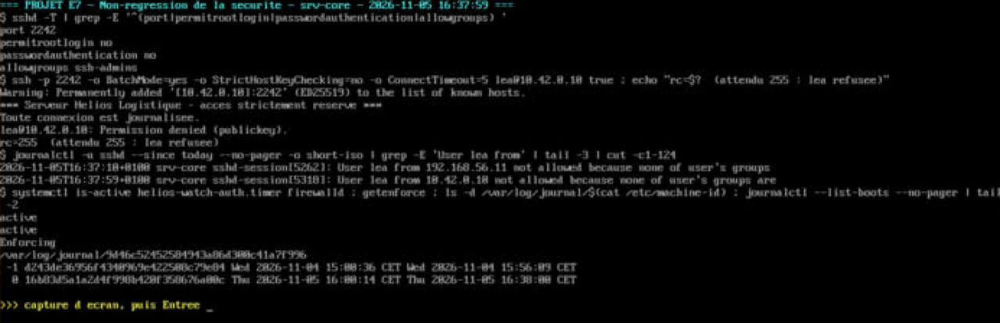

E8, la supervision. L'agent Zabbix et la collecte des statisitques système démarrent avec le serveur. La sonde du portail renvoie 200, et la sonde de fraîcheur indique que etat.json a été mis à jour il y a 24 secondes.

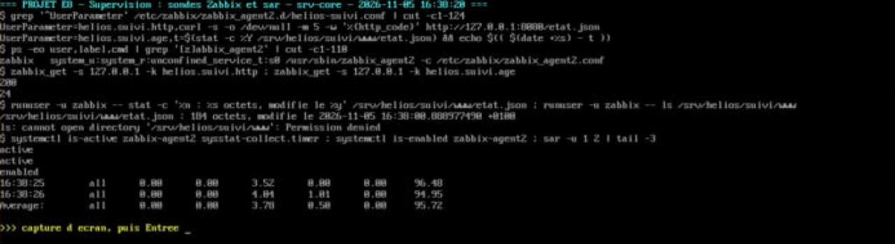

E9, la sauvegarde. Chaque sauvegarde crée une archive et son empreinte, et j'ai vérifié que l'empreinte est correcte. J'ai lancé 9 sauvegardes et seules les 7 dernières ont été gardées. La sauvegarde se lance tous les jours à 3h15, et si le serveur était éteint à cette heure là, elle se lance au démarage suivant. La restauration est expliquée dans la partie 3.

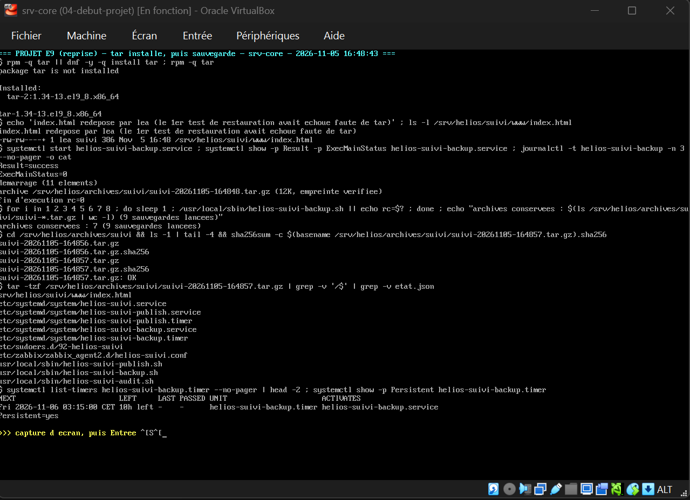

E10, l'audit (bonus). J'ai écrit un script qui vérifie toutes les exigences d'un coup. Il donne 9 sur 9, et toujours 9 sur 9 après un redémarrage du serveur. Quand j'arrête le portail, que je retire le port 8080 ou que je fausse une empreinte de sauvegarde, il détecte bien le probleme.

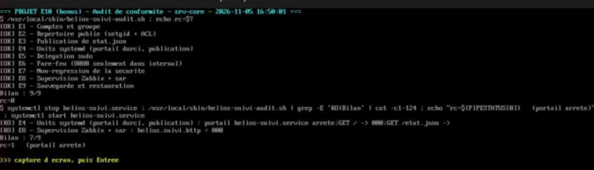

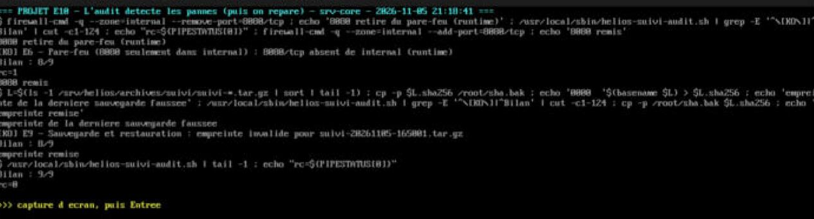

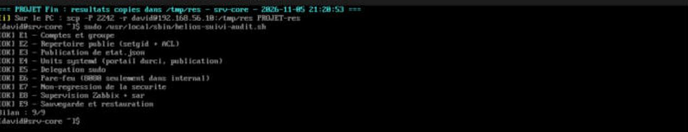

## 2. Mes trois justifications

Le durcissement du portail. Le portail tourne sous son propre compte, sans aucun privilège. Je lui ai interdit d'écrire où que ce soit sur le disque, même dans /tmp, puisqu'il n'a besoin que de lire. J'ai aussi protégé le noyau et les périphériques, limité les appels système qu'il peut faire, et autorisé seulement les connexions réseau dont il a besoin. Pour le vérifier, j'ai essayé d'écrire depuis le service, et le système a refusé à chaque fois. Aucune de ces protections n'a empêché le portail de fonctioner. La seule que je n'ai pas mise, c'est celle qui coupe complètement le réseau, puisqu'un serveur web en a besoin.

Pourquoi zabbix peut traverser le dossier mais pas le lister. Pour savoir si etat.json est à jour, zabbix a seulement besoin de lire la date du fichier. Pour ça, il doit pouvoir traverser le dossier, mais il n'a pas besoin de voir tous les fichiers qu'il contient. J'ai testé les trois cas. Sans aucun droit, zabbix ne peut pas lire la date et la sonde ne marche plus. Avec le droit de lister, la sonde marche, mais zabbix voit tout le contenu du dossier. Avec seulement le droit de traverser, la sonde marche et zabbix ne voit rien d'autre. J'ai donc gardé ce dernier cas, qui est le minimum nécéssaire.

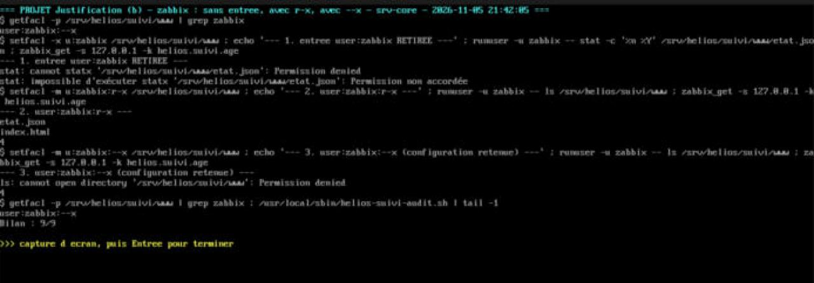

Pourquoi il ne faut pas mettre une étoile après journalctl dans sudo. Avec une étoile, lea pourrait ajouter n'importe quelle option en tant que root. Elle pourrait par exemple effacer tout le journal du serveur, ou lire les journeaux des autres services. En plus, journalctl affiche le résultat dans un lecteur de texte qui permet d'ouvrir un terminal root. Dans ma règle, j'ai donc écrit chaque commande en entier, avec l'option qui désactive ce lecteur. Sudo refuse tout ce qui est différent, et j'ai vérifié que lea ne peut pas vider le journal.

## 3. Test de restauration

D'abord, j'ai extrait la dernière sauvegarde dans un dossier de test, et j'ai vérifié que les droits du dossier www étaient identiques à ceux du serveur.

Ensuite, j'ai simulé un incident en supprimant la page d'acceuil, index.html. Le portail affichait alors la liste des fichiers au lieu de la page. J'ai restauré seulement ce fichier depuis l'archive, avec la commande tar en gardant les ACL et les attributs SELinux. La restauration a pris 0,03 seconde. Le fichier est revenu avec le même propriétaire, les mêmes droits et le même contenu, et la page s'affiche de nouveau.

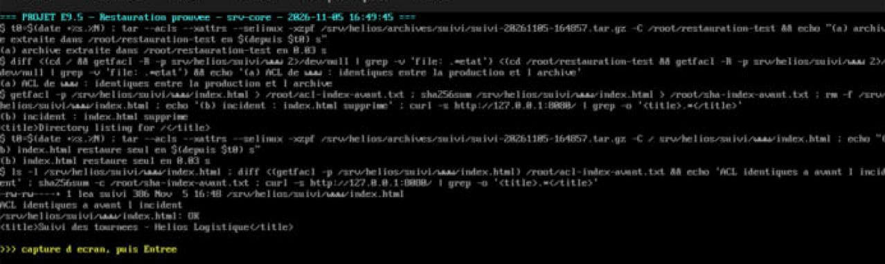

J'ai eu un imprévu au premier essai. L'outil tar n'était pas installé sur le serveur, donc la sauvegarde a échoué. Comme j'avais déjà supprimé index.html, je n'ai pas pu le restaurer. Mon script d'audit a tout de suite signalé le problème. J'ai installé tar, lea a redéposé la page, et j'ai refait le test avec succès. J'en retiens qu'il faut toujours vérifier qu'une sauvegarde valide existe avant de suprimer quoi que ce soit.

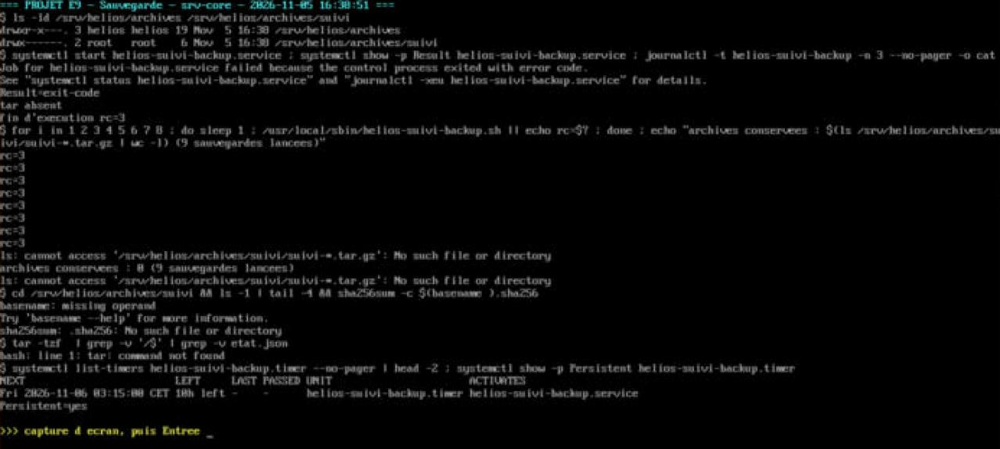

## 4. Mesure sous charge

J'ai envoyé 2000 requètes au portail à la suite, ce qui a pris 43,7 secondes. Avant le test, le portail avait consommé 0,24 seconde de processeur, et 4,59 secondes après. Sa mémoire est restée à 9,7 Mo du début à la fin.

La limite de 50 % de processeur n'a jamais été ateinte. Le portail n'a utilisé qu'environ 10 % d'un processeur, et le système ne l'a jamais freiné. Ce qui chargeait le serveur, c'était surtout les 2000 commandes curl lancées pour le test, pas le portail lui-même.

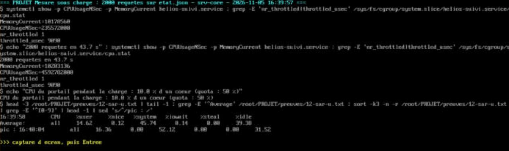

## 5. Limites connues

L'outil tar manquait sur le serveur. Je l'ai installé, mais il faudrait le vérifier avant chaque déploiment.

L'outil nc n'était pas installé sur srv-edge. J'ai donc fait le test du pare-feu avec une fontion intégrée à bash, qui donne le même résultat.

Le fichier de télémétrie du TP1 n'était pas lisible par le portail. J'ai ajouté un droit de lecture pour helios-suivi, sans toucher aux autres droits. Si ce fichier est recréé un jour, ce droit disparaîtra, mais la supervision le verra tout de suite puisque etat.json ne sera plus mis à jour.

Je n'ai pas fait le bonus E8.5, donc il n'y a pas de serveur Zabbix ni d'alertes.

Avec une journée de plus, j'installerais le serveur Zabbix avec des alertes, je ferais en sorte d'être prévenu quand une sauvegarde échoue, et je mettrais le portail derriere un vrai serveur web en HTTPS, parce que le petit serveur Python n'est pas fait pour la production.
