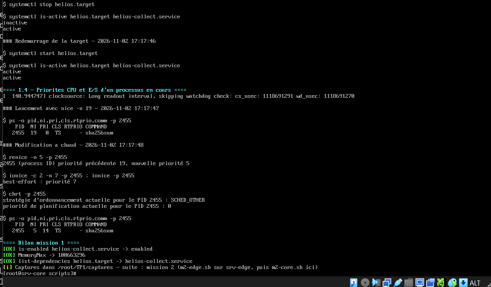
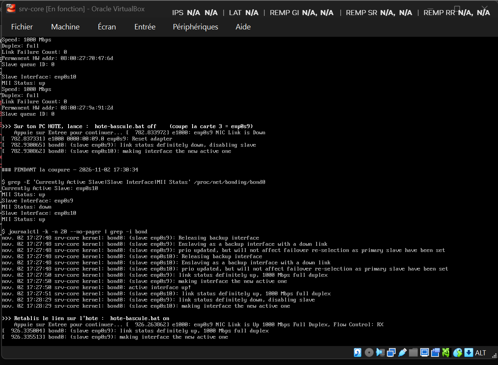
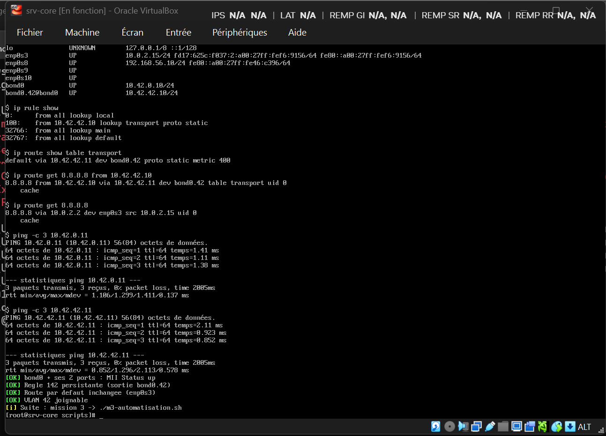
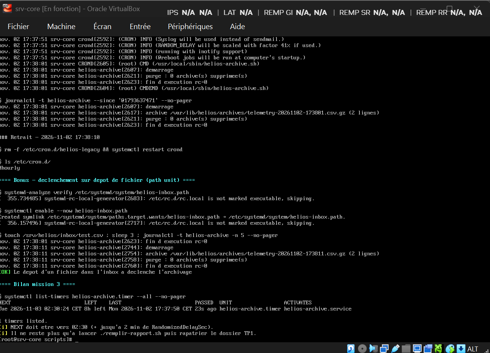

# TP1 — Configuration avancée du système Linux

**David** · BTC2 Administration Linux Server · VM `srv-core` + `srv-edge` (Rocky Linux 9.8, VirtualBox)

Les fichiers de config sont dans `configs/`, les sorties de commandes dans `captures/`.

---

## Mission 1 — Services et démarrage

### Temps de boot

| | Avant | Après |
|---|---|---|
| `systemd-analyze` | 1 min 27,7 s | **23,6 s** |
| Unité la plus lente | `NetworkManager-wait-online` (60 s) | `ttyS3` (10 s) |

- **firewalld** désactivé (temporaire, réactivé au TP3) : il charge toutes ses règles au boot.
- **NetworkManager-wait-online** masqué : il attendait 60 s un réseau « prêt » à cause des cartes `helios-lan` sans passerelle. J'ai utilisé `mask` et pas `disable`, car il est tiré automatiquement par `network-online.target`.

Graphes : `captures/boot-avant.svg` et `captures/boot-apres.svg`.

### Service helios-collect

- Tourne avec un compte système `helios` sans shell, pas en root.
- `Restart=on-failure` + `RestartSec=5s` : après un `kill -9`, le service est **relancé en 5 s** (PID 2085 → 2127).
- Le drop-in `override.conf` ajoute `CPUQuota=20%`, `MemoryMax=96M`, `Nice=5` et un intervalle de 5 s, sans toucher à l'unit d'origine. Résultat : `MemoryMax=100663296`.

**Score `systemd-analyze security` : 5.3 MEDIUM → 1.1 OK**, grâce à un 2ᵉ drop-in `hardening.conf` (`PrivateDevices`, `SystemCallFilter`, `ProtectKernelModules`…).

### Target et priorités

`helios.target` regroupe le service (`list-dependencies` le montre bien). Point remarqué : après `systemctl stop helios.target`, le service reste **actif**, car `Wants=` ne propage pas l'arrêt. Il faudrait `PartOf=` pour ça.

Priorités testées sur `sha256sum` : `nice 19` → `renice 5`, `ionice` best-effort niveau 7, `chrt` = SCHED_OTHER.

---

## Mission 2 — Réseau : bond, VLAN, routage

- **Bond `active-backup`** sur `enp0s9` + `enp0s10` (10.42.0.10). Le mode LACP est impossible sous VirtualBox. `fail_over_mac=active` est nécessaire car VirtualBox filtre par adresse MAC.
- **Bascule** : quand je coupe la carte 3, `enp0s10` prend le relais. Résultat : **2 pings perdus sur 238**.

- **VLAN 42** (`bond0.42`, 10.42.42.10) : `tcpdump` montre bien les trames marquées `vlan 42` (`captures/m2-tcpdump-vlan42.txt`).
- **Table 142 « transport »** : une règle envoie tout ce qui part de 10.42.42.10 vers srv-edge.
  - `ip route get 8.8.8.8 from 10.42.42.10` → sortie par `bond0.42`
  - `ip route get 8.8.8.8` → sortie par `enp0s3`
- Tout revient seul **après reboot** : config faite avec `nmcli`, donc persistante.

---

## Mission 3 — Script d'archivage et timer

Le script `helios-archive.sh` respecte les 5 règles d'un script de production :
- mode strict (`set -euo pipefail`) ;
- verrou `flock` ;
- `trap` de nettoyage ;
- logs dans journald avec `logger` ;
- codes retour explicites.

| Cas testé | Code attendu | Code obtenu |
|---|---|---|
| Normal | 0 | **0** |
| Verrou déjà pris | 2 | **2** |
| Fichier source absent | 3 | **3** |

Timer : tous les jours à 02:30, avec `Persistent=yes` et un décalage aléatoire de 2 min. Prochaine exécution : **03/11/2026 02:30:24**.

### Cron vs timer (d'après ce que j'ai observé)

| Critère | cron | timer systemd |
|---|---|---|
| Rattrapage si VM éteinte | Non, l'exécution est perdue | Oui : rattrapée tout de suite au redémarrage |
| Journalisation | Juste `CMD` / `CMDEND`, pas de code retour | Début, fin et code retour dans `journalctl -u` |
| Dépendances | Aucune | `ConditionPathExists`, `After=`… |
| Limiter les ressources | À la main (`nice`) | `Nice=`, `IOSchedulingClass=`, `CPUQuota=` |
| Étaler la charge | 02:30:00 pile | `RandomizedDelaySec` |
| Voir la prochaine exécution | Impossible | `systemctl list-timers` |

→ Le timer est meilleur sur tous les points pour une tâche qu'on veut surveiller.

**Bonus** : `helios-inbox.path` lance l'archivage dès qu'un fichier arrive dans `/srv/helios/inbox`. Testé : déclenché en moins de 3 s.

---

## Remarque

Dans le PDF, le `-printf` de la commande `find` avait perdu son tiret au passage à la ligne. Sans lui, le script d'archivage plante.
