# TP3 — Sécurisation d'un serveur Linux

**David** · BTC2 Administration Linux Server · VM `srv-core` (cible) et `srv-edge` (poste distant), Rocky Linux 9.8

Vous trouverez mes fichiers de configuation dans `configs/`, toutes les sorties de commandes dans `captures/` et les scripts que j'ai utilisés dans `scripts/`.

Deux remarques avant de commencer :
- Le compte administrateur s'appelle `david` chez moi, et non `sysops`. J'ai donc mis `david` partout ou l'énoncé parle de `sysops`.
- Sur srv-edge, je n'ai pas réussi à instaler `nmap`, et `nc` n'était pas présent non plus. Pour tester les ports, j'ai donc utilisé `/dev/tcp` de bash, dans une petite fonction `tcp` (voir `scripts/tp3-edge.sh`). Elle indique si le port est ouvert, fermé (connexion refusée), rejeté par le pare-feu ou filtré (aucune réponse). Pour la même raison, je n'ai pas de scan « avant » : l'état de départ est dans `captures/m1-etat-initial.txt`. On y voit que toutes les interfaces étaient dans la zone `public`, avec SSH ouvert partout.

---

## Mission 1 — Pare-feu firewalld par zones

J'ai réactivé firewalld, puis j'ai donné une zone à chaque connexion **dans NetworkManager** (`nmcli con mod … connection.zone`), et pas dans firewalld. C'est NetworkManager qui gère les intefaces, donc c'est son profil qui décide. Chez moi, le profil d'administration s'appelle `enp0s8` et non `admin`.

| Interface | Connexion | Zone | Politique | Pourquoi |
|---|---|---|---|---|
| enp0s3 (NAT, Internet) | enp0s3 | **drop** | rien n'entre, sans aucune réponse | Le serveur n'a rien à propser sur Internet. Avec drop, il ne répond même pas, donc il est invisible pour un scan. |
| enp0s8 (administration) | enp0s8 | **work** | SSH seulement, depuis 192.168.56.0/24, avec un débit limité et journalisé | C'est par là que les administrateurs arrivent. La limite de débit freine les ataques par force brute. |
| bond0 (métier) | bond0 | **internal** | SSH et supervision (10051) | C'est le réseau des serveurs, Zabbix doit pouvoir y joindre le port 10051. |
| bond0.42 (VLAN transport) | bond0.42 | **internal** | pareil que bond0 | C'est le même réseau de confiance, découpé en VLAN. |

La zone par défaut est **drop**. Une interface oubliée est donc fermée d'ofice. C'est aussi le cas de `enp0s9` et `enp0s10`, les deux cartes membres du bond : le trafic passe par `bond0`, donc elles n'ont pas besoin d'être ouvertes.

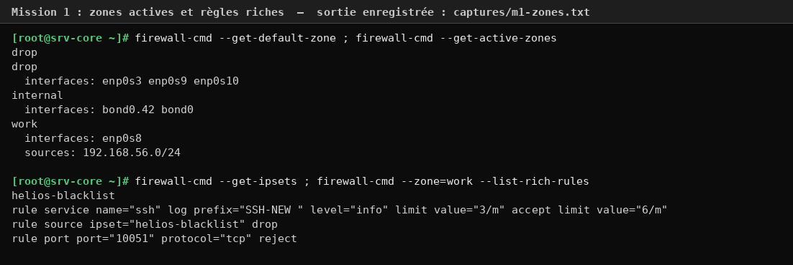
*Chaque interface est dans la bonne zone, et la zone par défaut est drop.*

Dans la zone `work`, j'ai ajouté trois règles riches. La première journalise les nouvelles connexions SSH avec le préfixe `SSH-NEW` et les limite à 6 par minute. La deuxième rejette le port 10051, qui n'a rien à faire sur le réseau d'administration. La troisième jette tout ce qui vient d'une adresse de l'ipset `helios-blacklist`, que la mission 3 remplit automatiquemnt.

En regardant la chaine nftables générée (`nft list chain inet firewalld filter_IN_work`), on voit que firewalld range tout seul les règles : d'abord les sous-chaînes `_log`, puis `_deny` (refus et liste noire), puis `_allow`. Une adresse bloquée est donc jetée **avant** de pouvoir arriver à la règle qui autorise SSH. On voit aussi que `iptables -S` est vide : sur Rocky 9, iptables n'est plus qu'une couche de compatibilité, c'est nftables qui fait le vrai travail.

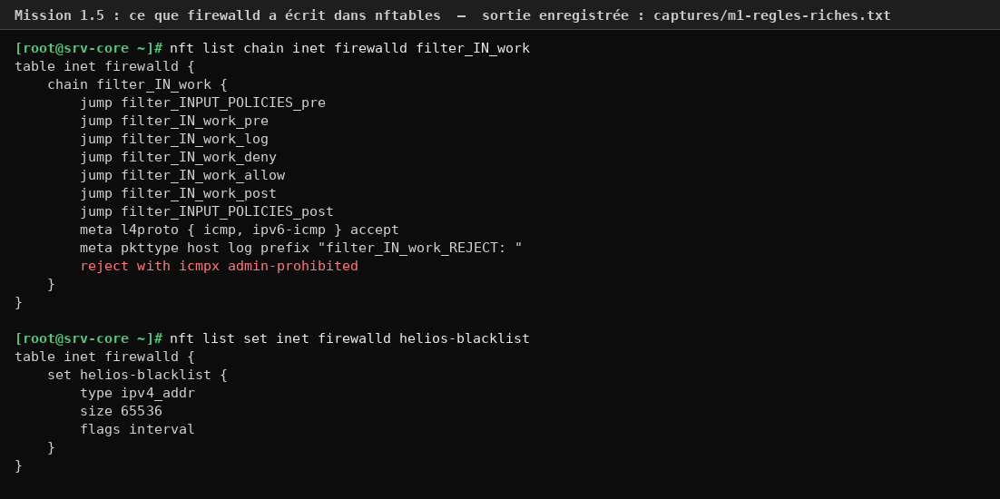
*La chaîne que firewalld a écrite dans nftables, et l'ipset encore vide.*

### Tests depuis srv-edge

J'ai fait ces tests aprés la mission 2, donc SSH était déjà sur le port 2242 :
- les ports 22 et 80 sont **rejetés** par le pare-feu ;
- le port 2242 est **ouvert** ;
- le port 10051 est **refusé** par la règle `reject`.

J'ai ensuite envoyé une rafale de 12 connexions. Seules les **5 premières** passent, ensuite le pare-feu répond `No route to host`. Il accepte en fait une rafale de 5, puis environ une connexion toutes les 10 secondes.

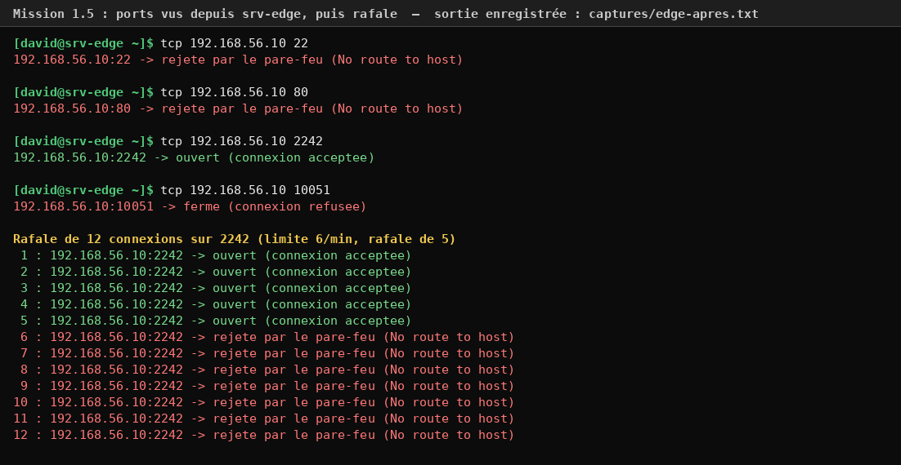
*Seul le port 2242 répond, et la limite de débit coupe la rafale à la 6e connexion.*

Les connexions acceptées laissent bien une trace `SSH-NEW` dans le journal du noyau (`captures/edge-preuves-core.txt`) :
```
srv-core kernel: SSH-NEW IN=enp0s8 … SRC=192.168.56.11 DST=192.168.56.10 … PROTO=TCP … DPT=2242 … SYN
```

---

## Mission 2 — Durcissement de sshd

Avant de toucher à quoi que ce soit, j'ai vérifié que la connexion **par clé** marchait depuis srv-edge (`ssh-copy-id`, puis `ssh … 'hostname ; id'`). J'ai aussi gardé une session ouverte tout le temps des modifcations, pour ne pas me retrouver enfermé dehors.

Tout le durcissement est dans `configs/10-helios-hardening.conf`. Voici les points principaux :
- le port **2242**, en écoute seulement sur 192.168.56.10 et 10.42.0.10 ;
- **clé obligatoire** (`AuthenticationMethods publickey`), sans mot de passe et sans root ;
- seul le groupe **`ssh-admins`** peut se connecter (david et julien) ;
- 3 essais au maximum, pas de redirection (X11, agent, tunnels), un journal détaillé (`VERBOSE`) et une bannière d'avertissement ;
- une seule exception : le groupe `helios-ops` peut ouvrir un tunnel, mais uniquement vers `localhost:10051`.

J'ai du ajouter un petit fichier en plus, `configs/90-helios-sshd.conf` (`net.ipv4.ip_nonlocal_bind = 1`). Au TP1, j'avais masqué `NetworkManager-wait-online`, donc au démarrage sshd peut se lancer avant que l'adresse 10.42.0.10 du VLAN existe, et il refuserait alors de démarrer. Ce réglage lui permet d'écouter sur cette adresse même si elle n'est pas encore montée.

### Les algorithmes : crypto-policies et sshd_config

Sur Rocky 9, sshd ne prend pas ses algorithmes dans `sshd_config`, mais dans la **politique cryptographique du système**. Ça se passe en trois étappes :
1. `sshd_config` commence par inclure `sshd_config.d/*.conf`, et les fichiers sont lus dans l'ordre alphabétique.
2. Le fichier `50-redhat.conf` inclut `/etc/crypto-policies/back-ends/opensshserver.config`, qui contient la liste des algorithmes de la politique.
3. sshd garde **la première valeur qu'il lit** pour chaque directive.

Une ligne `Ciphers` ou `KexAlgorithms` n'a donc d'effet que si elle est lue **avant** `50-redhat.conf`, et en dehors de tout bloc `Match`.

J'ai fait les deux approches de l'énoncé :
- **la politique système** : `update-crypto-policies --set DEFAULT:NO-SHA1` retire SHA-1 pour tout le système, y compris pour le client ssh et les autres logicels, pas seulement pour sshd ;
- **le fichier local `05-helios-crypto.conf`** : il commence par `05`, donc il est lu avant `50-redhat.conf`, et ses listes passent en premier. Je ne pouvais pas mettre ces lignes à la fin de `10-helios-hardening.conf`, parce qu'elles se retrouvaient dans le bloc `Match Group helios-ops`, et `sshd -t` les refuse à cet endroit.

Avec `sshd -T`, on voit qu'il ne reste que mes listes : 3 échanges de clés, 3 chiffrements et 2 MAC. Le test 7 le confirme : quand srv-edge demande `diffie-hellman-group14-sha1`, le serveur répond « no matching key exchange method » et propose seulement mes 3 algorithmes.

### Les trois conséquences d'un changement de port SSH sur RHEL 9

1. **La configuration de sshd** : il faut changer `Port`, et les clients doivent maintenat préciser `-p 2242` (ou `-P 2242` pour scp). Avec des `ListenAddress`, l'adresse doit aussi exister au démarrage, d'où mon réglage `ip_nonlocal_bind`.
2. **SELinux** : sshd n'a le droit d'écouter que sur les ports étiquetés `ssh_port_t`, et au départ il n'y a que le port 22. Sans `semanage port -a -t ssh_port_t -p tcp 2242`, sshd ne démarre pas. Je l'ai d'ailleurs vu dans mon journal : un de mes redémarrages a échoué avec `Bind to port 2242 … Permission denied` (et `aureport` compte d'ailleurs 2 refus SELinux, des AVC, sur la semaine). Après l'étiquetage, le port 2242 apparaît dans `semanage port -l`, et sshd écoute bien dessus.
3. **Le pare-feu** : il faut ouvrir 2242 (la règle riche limitée dans `work`, le port dans `internal`) **et** retirer le service `ssh`, sinon le port 22 resterait ouvert pour rien. Si on oublie d'ouvrir 2242, au contraire, on perd tout accés à distance.

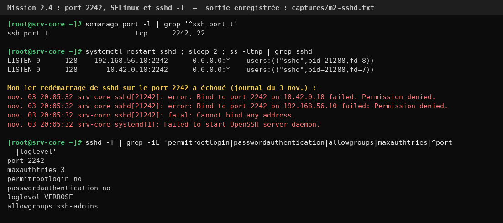
*Le port 2242 est étiqueté pour SSH, sshd écoute dessus, et on voit plus bas le refus du premier redémarrage.*

### Les sept tests depuis srv-edge

| # | Test | Résultat sur srv-edge | Ligne correspondante dans le journal de srv-core |
|---|---|---|---|
| 1 | ancien port 22 | rejeté par le pare-feu | aucune : le paquet n'arrive jamais jusqu'à sshd |
| 2 | david par clé sur 2242 | **accepté** | `Accepted publickey for david from 192.168.56.11 … ED25519` |
| 3 | root | `Permission denied (publickey)` | `User root from 192.168.56.11 not allowed because none of user's groups are listed in AllowGroups` |
| 4 | mot de passe forcé | `Permission denied (publickey)` : le serveur ne propose que la clé | `Connection closed by authenticating user david … [preauth]` |
| 5 | nadia (hors ssh-admins) | `Permission denied (publickey)` | `User nadia from 192.168.56.11 not allowed because none of user's groups are listed in AllowGroups` |
| 6 | tunnel vers 10051 | la connexion marche, mais le tunnel est refusé dés qu'on l'utilise (`administratively prohibited`) | la session de david s'ouvre normalement : le refus est renvoyé au client, car david n'est pas dans `helios-ops` |
| 7 | échange de clés SHA-1 | refusé | `Unable to negotiate … no matching key exchange method found. Their offer: diffie-hellman-group14-sha1` |

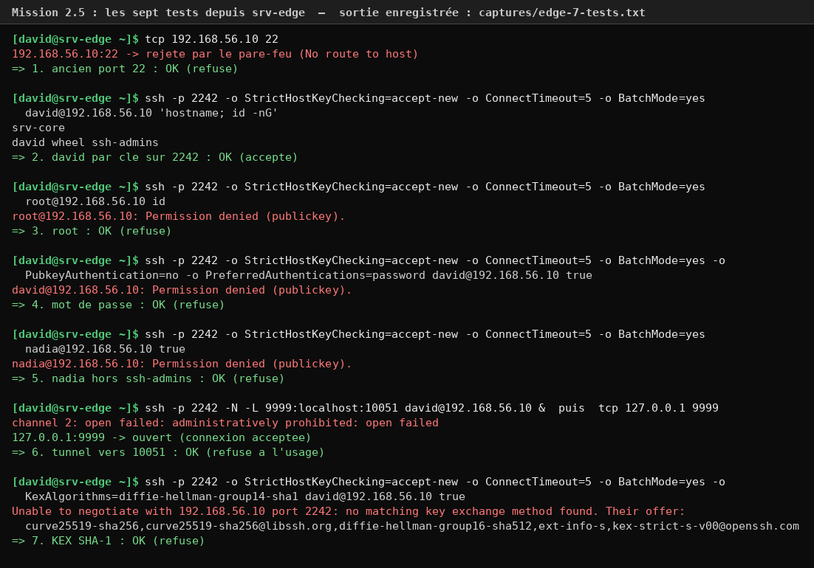
*Les sept tests, tous avec le résultat attendu.*

Les lignes de journal sont dans `captures/m2-journal-7-tests.txt`. Deux choses m'ont surpris :
- pour root, c'est `AllowGroups` qui bloque en premier, avant même `PermitRootLogin no`. Les deux protections se superpossent ;
- chaque connexion affiche `SHA1 in signatures is disabled for RSA keys` : c'est l'effet direct de la politique `NO-SHA1`.

Le journal plus ancien (`captures/m3-investigation.txt`) montre bien le changment : jusqu'au 3 novembre à 20h01, il y a des `Accepted password`. Après le durcissement, il n'y a plus que des `Accepted publickey`.

---

## Mission 3 — Journaux et détection

### journald persistant

Avec `configs/50-helios.conf`, le journal est écrit sur le disque (`Storage=persistent`), compressé et limité à 500 Mo et un mois. Il est aussi découpé en un fichier par jour. Après le redémarrage, `journalctl --list-boots` montre bien **2 démarrages**, alors qu'avant le TP aucun journal ne survivait à un redémarrage.

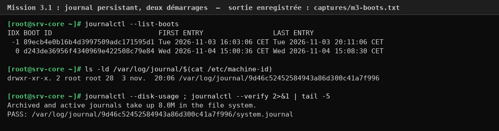
*Le démarrage du 3 novembre est toujours lisible après le redémarrage.*

### Cinq requêtes d'investigation

| Requête | Ce qu'elle m'a appris |
|---|---|
| `journalctl _SYSTEMD_UNIT=sshd.service -g 'Invalid user\|Failed\|Accepted'` | Jusqu'au 3 novembre à 20h01, toutes les connexions se fesaient **par mot de passe** depuis mon PC (192.168.56.1). La dernière est celle de srv-edge pendant le `ssh-copy-id`. Ensuite, il n'y a plus que des connexions par clé : le durcissement se voit directement dans le journal. |
| `journalctl --facility=authpriv --since today` | Toute l'activité d'authentification du jour au même endroit : sshd qui démarre sur le port 2242, **mon** erreur de mot de passe sur la console (`FAILED LOGIN 1 FROM tty1 FOR david`), puis le `sudo` que j'ai utilisé pour lancer le script. |
| `journalctl -t sudo -o json-pretty` | Le format JSON donne tous les champs d'un sudo : qui (`_AUDIT_LOGINUID=1000`), depuis quel terminal (`tty1`), la commande exacte (`_CMDLINE`) et la session. C'est pratique à envoyer dans un outil d'anlayse. |
| `journalctl -b -1 -p err` | Les erreurs du démarrage précédent : les `sudo vim` de nadia refusés (mon test du TP2), sshd qui n'arrive pas à se lier au port 2242 (SELinux), et julien bloqué par sudo sur `systemctl status` (le test auditd). Une seule commande résume les incidents de la veille. |
| `lastb -n 15 ; last -F` | `lastb` montre **14 échecs de connexion de nadia** le 3 novembre (c'était mon test faillock du TP2) et mon erreur d'aujourd'hui. `last` montre les sessions et les redémarrages, avec leur durée. |

Les deux autres requêtes n'ont rien renvoyé, et c'est aussi une informtion. Il n'y a eu aucun avertissement de sshd dans les 2 dernières heures. Et nadia (UID 5101) n'a rien fait aujourd'hui, ce qui est normal : elle n'a plus le droit de se connecter en SSH.

### auditd

Les règles de `configs/90-helios.rules` surveillent :
- les fichiers d'identité (`passwd`, `shadow`, `group`, `gshadow`) ;
- sudoers et la configuration sshd ;
- le programme `helios-lastlog` du TP2 ;
- `/etc/firewalld` ;
- **toute commande lancée en root par un humain** (`execve` avec `euid=0` et `auid>=1000`).

Ce que j'en retient, c'est que `auid` garde l'identité de la **vraie personne**, même après `sudo` ou `su`. Dans `ausearch -k privesc -i`, les commandes `tee`, `ausearch` et `tail` sont bien lancées en root, mais elles sont marquées `auid=david`. Avec `ausearch -k sudoers`, on retrouve aussi le `touch` puis le `rm` de `/etc/sudoers.d/test-audit`, et avec `-k helios-setgid` l'exécution de `helios-lastlog` par julien. Tout est dans `captures/m3-auditd.txt`.

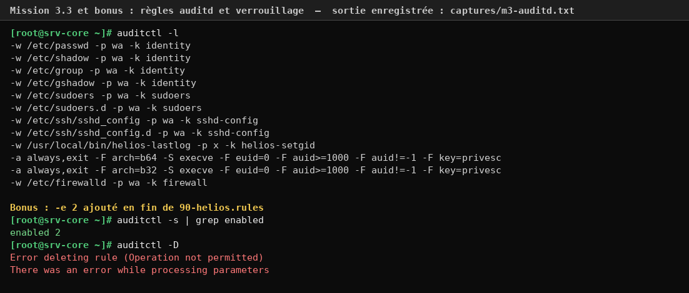
*Les règles chargées, puis, pour le bonus, le verrouillage : même root ne peut plus les supprimer.*

### Détection automatique et blocage

Le script `configs/helios-watchauth.sh` reprend le modèle du TP1 :
- il tourne en mode strict, avec un verrou `flock` : il renvoie **2** si une autre instance tourne déjà (je l'ai vérifié, `rc avec verrou pris : 2`) ;
- il compte les échecs SSH des 10 dernières minutes pour chaque adresse : utilisateur inconnu, mauvaise clé ou trop d'essais ;
- au-delà de 5 échecs, il ajoute l'adresse à l'ipset, en runtime et en permanent, et écrit une alerte dans le journal avec le tag `helios-watch-auth` ;
- il ne bloque jamais `192.168.56.1` (le poste du formateur) ni `127.0.0.1` ;
- il est idempotent : une adresse déja dans `blocked.txt` ou dans l'ipset est ignorée, donc il n'y a pas de deuxième alerte.

Le timer le lance toutes les 2 minutes (`OnCalendar=*:0/2`, `AccuracySec=10s`, `Persistent=no`).

**Ce qui s'est passé pendant l'attaque.** J'ai lancé 10 connexions `pirate@` depuis srv-edge. Seules les **5 premières** sont arrivées jusqu'a sshd : à partir de la 6e, c'est la limite de débit du pare-feu qui répondait `No route to host`. 5 échecs, ce n'est pas plus de 5, donc le script n'a pas encore bloqué. J'ai relancé l'attaque une minute plus tard : 5 échecs de plus, soit 10 au total. Au passage suivant du timer, à **15:16:11**, srv-edge a été bloquée.

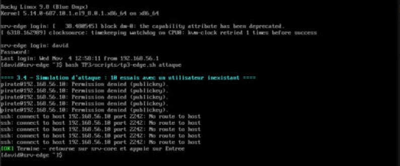
*Capture de la console de srv-edge : 5 refus de sshd, puis la limite de débit du pare-feu prend le relais.*

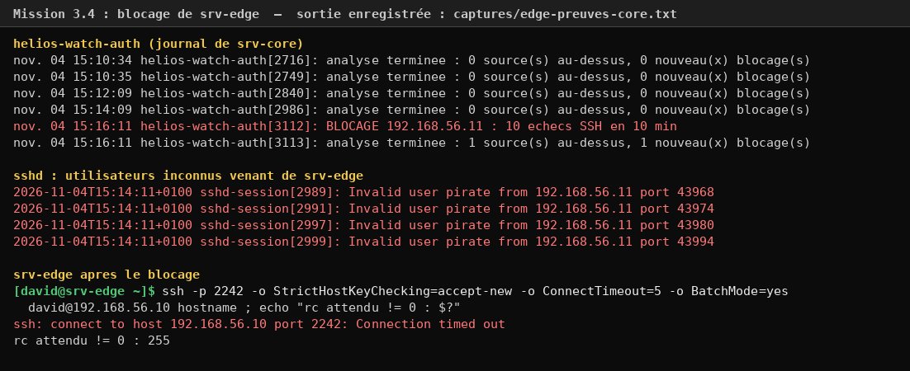
*Le timer détecte les 10 échecs et bloque srv-edge, qui n'arrive plus du tout à joindre le port 2242.*

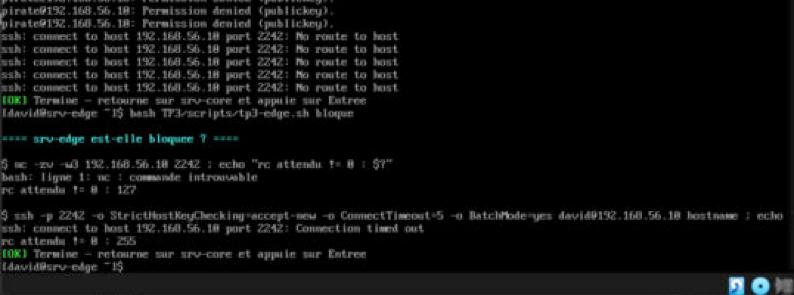
*Sur la console de srv-edge : `Connection timed out`. L'ipset jette les paquets sans aucune réponse.*

**Une limite que j'ai remarquée :** mon expression régulière compte les utilisateurs inconnus (`Invalid user`) et les mauvaises clés (`Failed …`). Mais les essais sur un compte qui existe et qui est refusé par `AllowGroups`, comme root ou nadia, apparaissent sous la forme `not allowed because …`, et le script ne les compte pas. Pour aller plus loin, il faudrait ajouter ce motif, parce qu'un attaquant essaie presque toujour `root` en premier.

Pour débloquer srv-edge, j'ai d'abord arrêté le timer, sinon il l'aurait rebloquée tant que les échecs restaient dans la fenêtre de 10 minutes. J'ai ensuite retiré l'adresse de l'ipset (runtime et permanent : les deux `success` dans `captures/m3-blocage.txt` montrent qu'elle y était bien), puis de `blocked.txt`. Enfin, j'ai programmé le redémarrage du timer 11 minutes plus tard. Il est bien reparti à 15:28 sans rebloquer personne.

---

## Bonus

**1. Règles auditd immuables.** Avec `-e 2` à la fin du fichier, `auditctl -s` affiche `enabled 2` et `auditctl -D` répond `Operation not permitted`, même en root. Un attaquant devenu root ne peut donc plus efacer ses traces sans redémarrer, et un redémarrage, ça se voit. J'ai ensuite retiré `-e 2` : après le redémarrage, on est revenu à `enabled 1`.

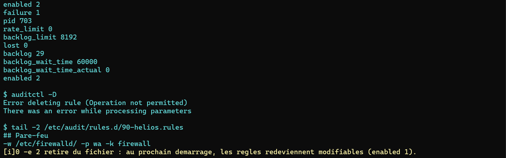
*Capture de mon terminal : `enabled 2`, puis la suppression des règles refusée.*

**2. aureport** (`captures/bonus-aureport.txt`). Sur la semaine, il y a 3 660 événements, dont 55 authentifications échouées (surtout mes tests du TP2) et 2 refus SELinux. Les programmes les plus présents sont `sshd-session`, `su`, `systemd` et `sudo`.

**3. Revue cryptographique.** `ssh -Q cipher` et `ssh -Q kex` montrent tout ce que le logiciel **sait faire**, y compris des algorithmes dépassés comme `3des-cbc` ou `diffie-hellman-group1-sha1`. Mais `sshd -T` montre que mon serveur ne **propose** plus que des algorithmes récents : curve25519, AES-GCM, ChaCha20 et des MAC en mode ETM. Je remarque quand meme qu'OpenSSH connaît aussi `mlkem768x25519-sha256`, un échange de clés résistant aux ordinateurs quantiques. Ma liste dans `05-helios-crypto.conf` l'exclut, donc ce serait une amélioration à faire.

**Pourquoi `AuthenticationMethods publickey` est plus fort que `PasswordAuthentication no` tout seul :** `PasswordAuthentication no` ne coupe qu'**une** méthode. Si `KbdInteractiveAuthentication` (qui passe par PAM) ou une autre méthode restait activée, un mot de passe pourrait encore être demandé par ce chemin-là. `AuthenticationMethods publickey` fonctionne à l'inverse, comme une liste blanche : seule la clé est acceptée, peu importe ce qui est activé à côté. Il faudrait donc se tromper sur plusieurs directves à la fois pour rouvrir l'accès par mot de passe.
